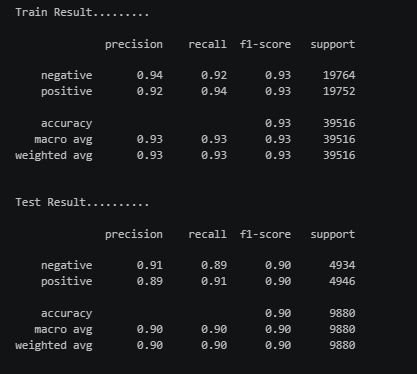
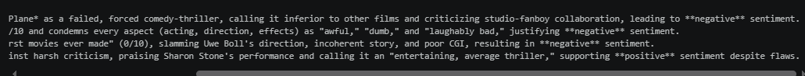

# IMDB Movie Review Sentiment Analysis

This project is a Movie Review Sentiment Analysis system developed using Python, Natural Language Processing (NLP), and Machine Learning.

I built this project to predict whether a movie review is positive or negative. The model uses TF-IDF Vectorization to convert text into numerical features and Logistic Regression to classify the sentiment.

## About the Dataset

The project uses the IMDB Movie Review Dataset, which contains movie reviews labeled as:

- Positive
- Negative

The reviews are cleaned and preprocessed before training the model.

## Technologies Used

- Python
- Pandas
- NumPy
- Scikit-learn
- NLP
- TF-IDF Vectorizer
- Logistic Regression
- Joblib
- Jupyter Notebook

## Project Workflow

1. Load and explore the IMDB dataset.
2. Clean the reviews by removing punctuation, special characters, and stopwords.
3. Convert text to lowercase.
4. Split the data into training and testing sets.
5. Convert reviews into numerical features using TF-IDF.
6. Train the Logistic Regression model.
7. Evaluate the model using accuracy, precision, recall, F1-score, and confusion matrix.
8. Save the trained model using Joblib.
9. Predict the sentiment of new movie reviews.

## Features

- Positive and negative sentiment classification
- NLP-based text preprocessing
- TF-IDF feature extraction
- Logistic Regression classification
- Model evaluation and performance analysis
- Prediction on custom movie reviews

## Model Performance

The model is evaluated using a classification report and confusion matrix.



## Sample Predictions

The trained model can predict the sentiment of new movie reviews.



## Project Structure

```text
IMDB_Sentiment_Analysis/
│
├── IMDB(1).ipynb
├── IMDB_Pred.ipynb
├── imdb_dataset.csv
├── imdb_sentiment_model.pkl
├── classification.png
├── output.png
└── README.md
```

## How to Run

**1. Clone the repository**

```bash
git clone https://github.com/SachinDevarajan/IMDB_Sentiment_Analysis.git
cd IMDB_Sentiment_Analysis
```

**2. Install the required libraries**

```bash
pip install pandas numpy scikit-learn joblib notebook
```

**3. Run the training notebook**

```bash
jupyter notebook "IMDB(1).ipynb"
```

**4. Run the prediction notebook**

```bash
jupyter notebook IMDB_Pred.ipynb
```

## What I Learned

Through this project, I gained practical experience in:

- Natural Language Processing
- Text preprocessing and cleaning
- TF-IDF Vectorization
- Logistic Regression
- Sentiment classification
- Machine Learning model evaluation
- Saving and loading trained models using Joblib

## Author

**Sachin Devarajan**

GitHub: [SachinDevarajan](https://github.com/SachinDevarajan)

LinkedIn: [Sachin Devarajan](https://linkedin.com/in/sachindevarajan)
